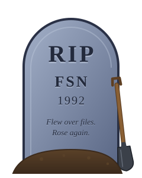

<p align="center"></p>

# Repo In Peace

Repo In Peace turns a JavaScript or TypeScript repository into a haunted 3D graveyard, so you can find and bury dead code. Folders are fenced plots, files are tombstones (taller for more lines), and every effect means one fact: moss for a file left untouched, a lean for an ancient one, cracks and a faint red glow for a file Knip reports unused, a lit candle for a hot one, and a translucent ghost for a deleted file. It is a nod to SGI's FSN, the early-1990s 3D file browser, made for Kiroween 2026 (Resurrection).

## For judges: how to test

**1. Open it.** <LIVE_URL>. No login or setup. Use a desktop browser with WebGL (recent Chrome, Edge, Firefox or Safari). A mouse is easiest; on a trackpad, one-finger drag orbits and Shift + drag pans.

**2. Pick a graveyard.** The boot screen lists the two demos: `spatialql` has ghosts (deleted files); `oikos_ledger` has the most variety. Direct links skip the boot screen:
- <LIVE_URL>/?graveyard=demo.spatialql
- <LIVE_URL>/?graveyard=demo.oikosledger

**3. Things to try (about 5 minutes).**
- Watch the camera rise into the overview, then find clean, mossy, leaning, cracked (unused) and candlelit (busy) stones, and the floating ghosts. The **Legend** explains each.
- Click a cracked stone: its facts, which files import it, and its eulogy.
- Open the **List** (sorted by decay, most dead first) and click a row to fly to it. Press `/` to search.
- **Bury** an unused stone: confirm, watch the gravedigger, then follow the link to the pull request on GitHub. It deletes exactly that one file on a demo fork.
- **Resurrect** a ghost in spatialql: the ghost rises, a stone forms, and a new pull request restores the file as it was.
- Press `?` for all the controls; Home, or a double-click on empty space, returns to the overview.

**4. About the pull requests.** They go to demo forks in the `repo-in-peace-demo` organisation, never to the original repositories, and always as a pull request. Bury twice on the same file and you get the same pull request. Limits: 3 pull requests a minute and 20 an hour per visitor, and at most 50 open on each fork; if a limit is hit, the app says so. The forks are reset from time to time.

**5. Analyse your own repo (optional).** See [Analyse your own repo](#analyse-your-own-repo).

**6. Known limits.** JavaScript and TypeScript repositories only; desktop browsers; with "Reduce motion" on, the animations are replaced by instant changes.

## How it fits together

```
analyser/   a local git clone in, one graveyard data file (JSON) out       (Node, TypeScript)
shared/     the data file's versioned schema, used by both sides
frontend/   the graveyard in the browser: boot screen → digging → scene    (Vite, React, three.js)
```

The analyser runs ahead of time. The browser only reads data files (the demos in `frontend/public/graveyards/`, or a file you pick), and never calls the GitHub API or uploads anything; Bury and Resurrect go through one serverless function (below).

## Walk a graveyard

```
cd frontend
npm install
npm run dev        # http://localhost:5173/
```

1. **Landing page.** The bare address shows the logo, the title and two buttons; **Enter the graveyard** (or **Take the tour**, which for now does the same) opens the boot screen at `?boot`, and Back returns to the landing page.
2. **Boot screen.** A green terminal that types a short boot (any key or click skips it) and lists the demo graveyards with their file counts; the first is marked, so Enter opens it. **Open a graveyard file…** (or a file dropped on the screen) reads a `.graveyard.json` in your browser only. No file yet? See [Analyse your own repo](#analyse-your-own-repo).
3. **Digging.** A short screen while the file loads and the scene is built, with the real counts ("exhuming 129 graves…").
4. **Scene.** The camera rises from a low shot into the overview (any input ends the move). Hover a grave for a summary line, click it for the detail panel, browse every grave in the list, or search with `/` or Cmd+K. "← Graveyards" (or the browser's Back) returns to the boot screen.

A direct link such as `?graveyard=demo.oikosledger` skips the landing page and the boot screen and goes straight to digging, then the scene. A file opened from disk is not kept across a reload: a reload returns to the boot screen.

## Bury and Resurrect

On the demo graveyards, **Bury** on an unused stone opens a real pull request that deletes the file, and **Resurrect** on a ghost opens one that restores it byte for byte as it was at its last commit. Both go to demo forks in a GitHub organisation of their own, never to the original repositories, and always as a pull request. A small serverless function (`frontend/api/pr.ts`) opens them; it checks every request against the demo's data file on the server and holds the only token, scoped to the forks. A gravedigger buries the stone and a fresh grave takes its place, or the ghost screams, rises into the sky and a stone forms where it was, each with a stake showing the pull request number. Open pull requests are live: on a later visit, a grave with one still open shows its fresh grave or restored stone at once, and the panel links to it; closed or merged ones show nothing. See `frontend/README.md`.

## Analyse your own repo

Try Repo In Peace on a JavaScript or TypeScript repository of your own, on your machine. Part A shows it as a graveyard; Part B (optional) makes Bury and Resurrect open real pull requests on a repository you control. Nothing is uploaded anywhere, except the pull requests in Part B.

### Quickest way

With Node 20.19+ (or 22.12+), a **full** clone of your repo, and its dependencies installed (`npm install` in it), run this from any folder outside the clone:

```
npx repo-in-peace path/to/your-repo --out your-repo.graveyard.json
```

Then open <LIVE_URL>, choose **Enter the graveyard**, and use **Open a graveyard file…** to pick `your-repo.graveyard.json`. It is read in your browser and never uploaded. Every flag below works the same (`npx repo-in-peace --help` lists them).

The full route that follows (clone Repo In Peace and run it locally) is needed for Bury and Resurrect on your own repo (Part B).

### Part A: see your repo as a graveyard

**1. What you need:** Node 20.19 or later (or 22.12+), git, and a JavaScript or TypeScript repository.

**2. Get Repo In Peace and install it**

```
git clone https://github.com/sl2902/repo-in-peace.git
cd repo-in-peace
(cd analyser && npm install)
(cd frontend && npm install)
```

**3. Prepare your repo.** Clone it in full (not shallow: ages, ghosts and Resurrect all come from its whole history), and install its dependencies (Knip needs them to tell which files are used):

```
git clone https://github.com/<owner>/<repo>.git ~/graveyards/<repo>
(cd ~/graveyards/<repo> && npm install)
```

**4. Run the analyser**, writing into the frontend's graveyard folder so the boot screen lists it by itself:

```
cd analyser
npm run analyse -- ~/graveyards/<repo> --out ../frontend/public/graveyards/<repo>.graveyard.json
```

The file name, without `.graveyard.json`, is the graveyard's name (`<repo>` here). The flags you may need:

| Flag | When |
| --- | --- |
| `--knip-dir app` | the JS/TS lives in a subfolder with its own `package.json`; repeat it for several folders |
| `--knip-config knip.json` | the repo has no Knip config, and Knip's defaults call test files or scripts unused |
| `--stale-after 30 --ancient-after 90` | a young or busy repo: the defaults (90 and 360 days) would call everything fresh |

All the options are in [`analyser/README.md`](analyser/README.md).

**5. Eulogies (optional).** An epitaph for every grave, written by a model on your machine. Install [Ollama](https://ollama.com), then:

```
ollama pull qwen2.5:7b
npm run analyse -- ~/graveyards/<repo> --out ../frontend/public/graveyards/<repo>.graveyard.json --eulogies --eulogy-model qwen2.5:7b
```

Only commit subjects and file contents are sent, and only to Ollama on this machine; names and e-mails are taken out first.

**6. Open it**

```
cd ../frontend
npm run dev
```

Go to <http://localhost:5173/>, choose **Enter the graveyard**, and pick your graveyard on the boot screen. Or save the file anywhere and use **Open a graveyard file…** on the boot screen (here or on the [live site](https://repo-in-peace-pi.vercel.app)): it is read in your browser and never uploaded, but Bury and Resurrect stay off for a file opened this way.

### Part B (optional): Bury and Resurrect on your own repo

> **This opens real pull requests on a GitHub repository you control.** Use a fork or a test copy, not your main project, until you're comfortable. Nothing is ever merged for you: every change is a pull request you review.

**1. A token.** On GitHub, go to Settings → Developer settings → [Fine-grained tokens](https://github.com/settings/personal-access-tokens/new). Choose **Only select repositories** and pick that one repository. Under Repository permissions, set **Contents** and **Pull requests** to **Read and write**.

**2. Local settings.** Create `frontend/.env.local` (it is git-ignored: `git check-ignore frontend/.env.local` should print the path):

```
GITHUB_TOKEN=github_pat_your_token_here
RIP_DEMOS={"<repo>":{"repo":"<owner>/<repo>","base":"main"}}
```

The key is the graveyard's name from step A4, `repo` is the GitHub repository the pull requests go to, and `base` is its branch. With `RIP_DEMOS` set, only the graveyards it names get the buttons (the bundled demos are then off locally).

**3. Restart the dev server** (`npm run dev`). On your graveyard, **Bury** (on an unused stone) and **Resurrect** (on a ghost) now open real pull requests.

**4. What to expect.** Bury needs the file to still be on the base branch, and Resurrect needs its path to be free there; otherwise the app refuses with a message saying why. If your repository has moved on since you ran the analyser, run it again. Burying the same file twice gives back the same pull request.

**5. Cleaning up.** From `frontend/`, close every Repo In Peace pull request on the repositories in `RIP_DEMOS` and delete their `rip/` branches (nothing else is touched):

```
npm run reset-demo-prs -- --dry-run     # lists what it would do
npm run reset-demo-prs
```

When you're done, delete the token on GitHub and remove `frontend/.env.local`.

### Troubleshooting

- **"… is a shallow clone"**: run `git fetch --unshallow` in your clone, or clone it again without `--depth`.
- **"No package.json found …"**: the JS/TS is in a subfolder; the message lists the folders that have one. Add `--knip-dir <folder>`.
- **"Knip failed …"**: usually the repo's dependencies aren't installed. Run `npm install` in it (or in the `--knip-dir` folder) and try again.
- **Ollama not running, or the model missing**: start Ollama (`ollama serve`), or `ollama pull <model>`; the analyser stops before anything else and says which.
- **Bury and Resurrect are greyed out**: no `GITHUB_TOKEN`, or no `RIP_DEMOS` entry for this graveyard's name, or the dev server wasn't restarted, or the graveyard was opened with **Open a graveyard file…** rather than picked from the boot screen's list.

## Licence

MIT, see `LICENSE`. Everything the scene shows is made in code; see `docs/credits.md`.
